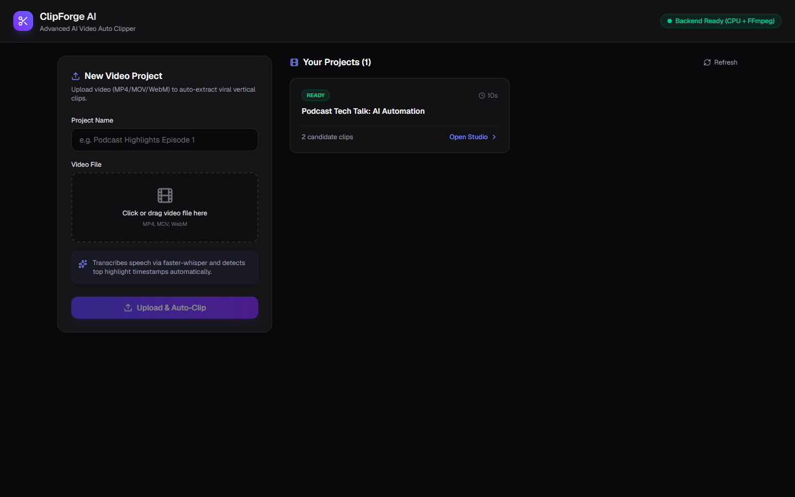
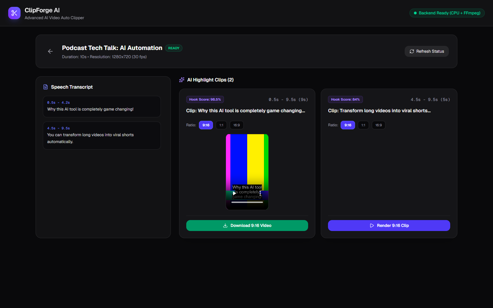

# ClipForge AI — Advanced AI Video Auto Clipper

Platform otomatisasi pemrosesan video panjang (*long-form*) menjadi klip pendek viral (TikTok, YouTube Shorts, Instagram Reels) dengan transkripsi AI lokal (`faster-whisper`), pendeteksi highlight otomatis, dan *burned-in subtitle rendering* via FFmpeg.

---

## 📸 Antarmuka & Alur Kerja (Screenshots)

### 1. Dashboard & Unggah Video
Halaman utama untuk mengunggah berkas video (MP4, MOV, WebM) dan memantau status proyek video yang sedang diproses.



- **Upload & Auto-Clip**: Masukkan judul proyek dan pilih berkas video. Sistem otomatis melakukan ekstraksi metadata, pemisahan audio, dan transkripsi.
- **Your Projects**: Menampilkan daftar proyek yang tersimpan dengan indikator status riil (`READY`, `ANALYZING`, atau `FAILED`) serta jumlah kandidat klip yang dihasilkan.

---

### 2. Studio Workspace & Clip Editor
Ruang kerja untuk meninjau hasil transkripsi ucapan per timestamp, memilih rasio aspek video, merender klip dengan subtitle permanen, dan mengunduh hasilnya.



- **Speech Transcript Panel (Kiri)**: Menampilkan transkripsi kata dan kalimat lengkap dengan penanda waktu (*timestamp start & end*).
- **AI Highlight Clips (Kanan)**:
  - **Hook Score (%)**: Menilai tingkat daya tarik klip berdasarkan densitas kata dan *opening hook*.
  - **Aspect Ratio Selector**: Pilih rasio `9:16` (Vertical / Reels / TikTok), `1:1` (Square), atau `16:9` (Landscape).
  - **In-App Video Preview**: Pemutar video bawaan untuk memutar klip hasil render dengan subtitle *burned-in* sebelum diunduh.
  - **Download Button**: Mengunduh video hasil render langsung ke penyimpanan lokal.

---

## 🚀 Panduan Penggunaan

1. **Unggah Video**:
   - Masukkan nama proyek pada form **New Video Project**.
   - Pilih file video Anda (misalnya rekaman podcast, webinar, atau presentasi).
   - Klik **Upload & Auto-Clip**.
2. **Proses AI Otomatis**:
   - Sistem mengekstrak audio dalam format WAV 16kHz.
   - Model `faster-whisper` mentranskripsi ucapan dan mencatat timestamp tiap segmen.
   - Algoritma heuristik menganalisis batas kalimat, densitas percakapan, dan kata kunci hook untuk menghasilkan kandidat klip 5–60 detik.
3. **Buka Proyek di Studio**:
   - Klik **Open Studio** pada kartu proyek yang berstatus `READY`.
   - Periksa segmen transkrip pada panel kiri.
4. **Pilih Rasio & Render Klip**:
   - Tentukan rasio aspek yang diinginkan (`9:16`, `1:1`, atau `16:9`) pada kandidat klip pilihan.
   - Klik **Render Clip**. FFmpeg akan memotong segmen waktu yang tepat, melakukan *smart cropping*, dan membakar (*burn*) subtitle bergaya kontras tinggi.
5. **Preview & Unduh**:
   - Putar video hasil potongan langsung pada kartu klip.
   - Klik tombol hijau **Download Video** untuk menyimpan hasilnya.

---

## 🛠️ Arsitektur Teknologi

- **Frontend**: Next.js 16 (App Router), React, TypeScript, Tailwind CSS, Lucide Icons
- **Backend**: FastAPI (Python 3.12), SQLAlchemy 2.0 (SQLite / PostgreSQL ready), Pydantic v2
- **Video Processing Engine**: FFmpeg 9.0 + FFprobe (Lanczos scaling, auto-centering crop, libass subtitle burn filter)
- **Speech-to-Text**: `faster-whisper` (CPU int8 mode, hemat sumber daya tanpa mewajibkan GPU)
- **Highlight Engine**: Boundary detection berbasis timestamp transkrip, deteksi jeda ucapan, dan kalkulasi hook score
- **Containerization**: Dockerfile & `docker-compose.yml` untuk deployment terisolasi

---

## 💻 Menjalankan Secara Lokal

### Prasyarat
- Python 3.12+
- Node.js 20+ & npm
- FFmpeg & FFprobe terpasang pada PATH sistem

### 1. Backend (FastAPI)

```bash
cd backend

# Membuat virtual environment dan memasang dependensi (atau gunakan uv)
python -m venv ../.venv
../.venv/Scripts/pip install -r requirements.txt

# Menjalankan server backend
../.venv/Scripts/python -m uvicorn app.main:app --host 127.0.0.1 --port 8000
```
API Documentation (Swagger UI) dapat diakses melalui: `http://127.0.0.1:8000/docs`

### 2. Frontend (Next.js)

```bash
cd frontend

# Memasang dependensi
npm install --ignore-scripts

# Menjalankan development server
npm run dev
```
Buka peramban di: `http://localhost:3000`

---

## 🧪 Pengujian Terotomatisasi (Pipeline Verification)

Jalankan skrip verifikasi *end-to-end* tanpa perlu menyiapkan video riil secara manual. Skrip akan membuat video uji coba sintetis 10 detik dengan FFmpeg, melakukan probing metadata, ekstraksi audio, kalkulasi kandidat klip, serta merender klip 9:16 bersubtitle:

```bash
cd backend
../.venv/Scripts/python -m tests.test_pipeline
```

Output yang diharapkan:
```text
[1] Generating synthetic video...
[2] Probing media with ffprobe...
    Probed: 1280x720, 10.0s, fps=30.0
[3] Extracting audio...
    Audio extracted successfully.
[4] Generating highlight candidates...
    Selected candidate: Clip: Why this AI tool is completely... (1.0s - 9.0s, score=100.0)
[5] Generating subtitles...
[6] Rendering 9:16 vertical clip with burned subtitles...
[7] Verifying rendered clip dimensions and format...
    Rendered output: 720x1280, duration: 8.0s

[SUCCESS] Pipeline verified: End-to-end video processing works completely.
```
